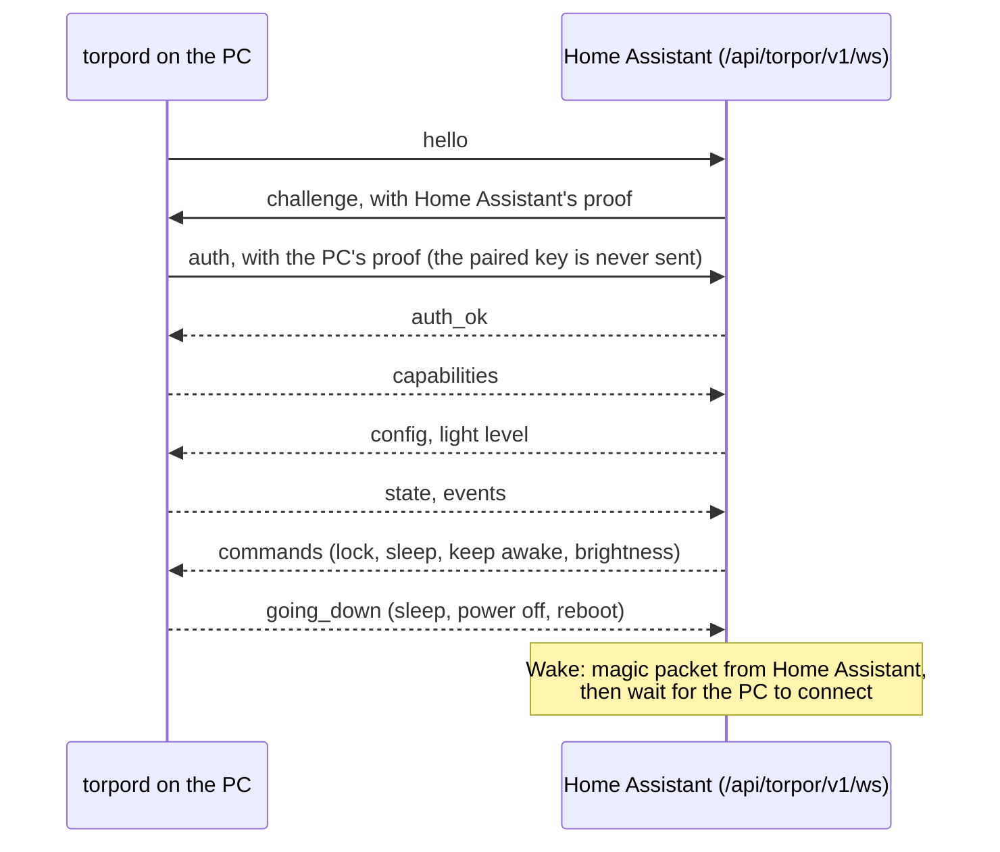

# How it works

The README covers using the integration. This page is the picture behind it: how the PC and Home
Assistant talk, which versions work together, and what has been tested.

The PC always dials; Home Assistant never connects to it, and the PC listens on no port. It pushes
every change as it happens. Home Assistant proves the key first, then the PC; after that every
message is encrypted with ChaCha20-Poly1305 under keys made fresh for each connection. The protocol
is specified in [docs/protocol.md](https://github.com/ovflowd/torpor/blob/main/docs/protocol.md) in
the agent's repository. This integration ships the same `protocol.py` byte for byte, and the same
test vectors.

[security.md](security.md) says what the integration stores and what the PC sends.

## Versions

This integration 0.1 speaks protocol 1, as does agent 0.1.

## Compatibility

The test suite runs against Home Assistant 2026.11.0, with a fake agent that speaks the real
protocol through the real endpoint. Nothing has been tested against a real PC yet; the first real
run will be on Arch-based CachyOS with Plasma 6.8. What each desktop supports is in the agent's
[module docs](https://github.com/ovflowd/torpor/tree/main/docs/modules).
